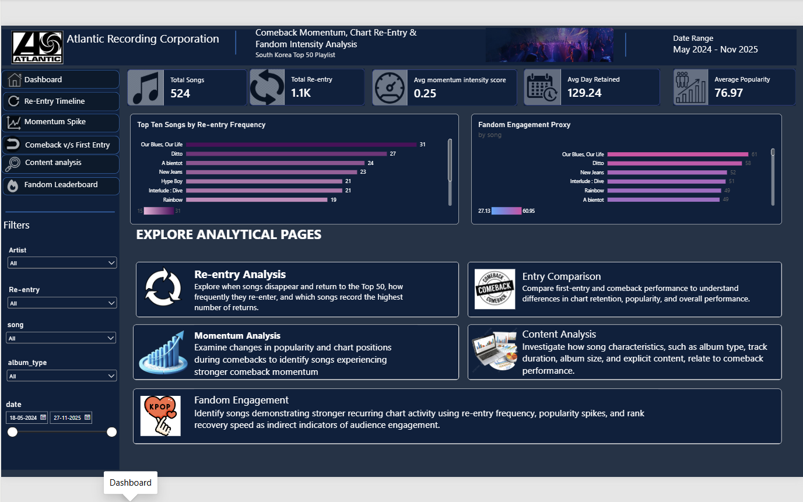
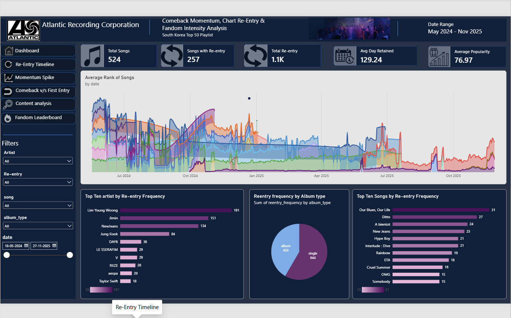
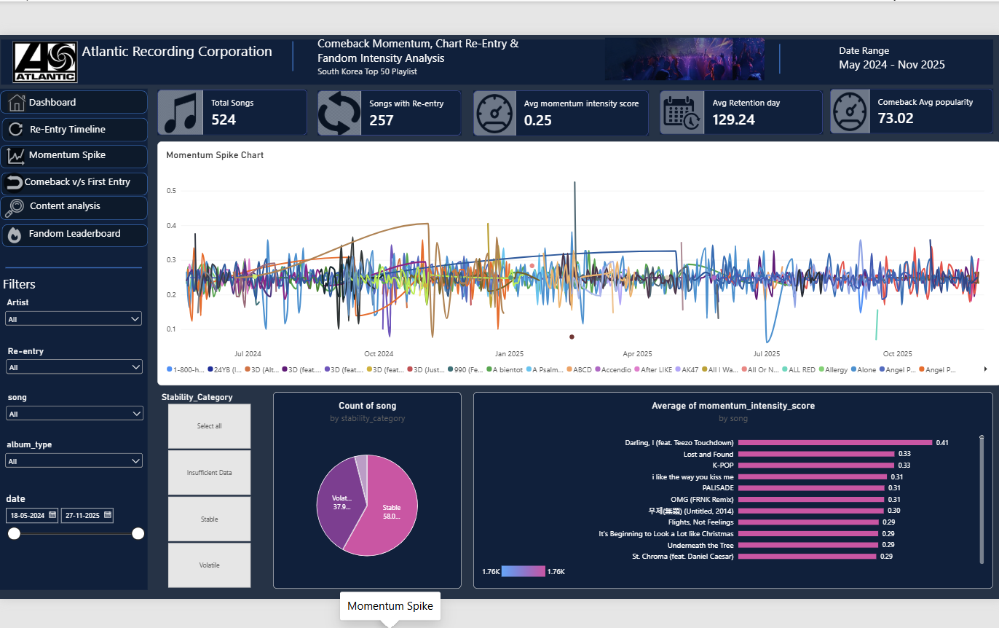
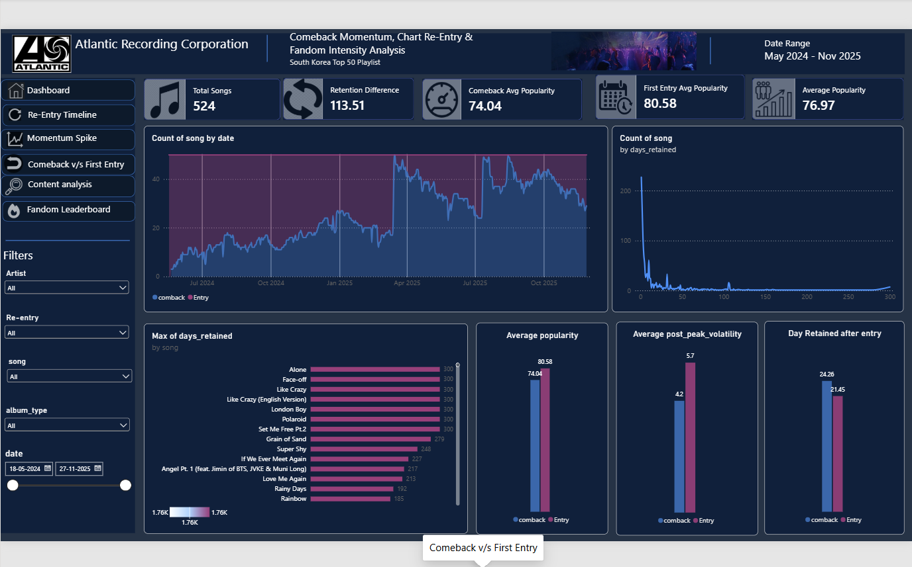
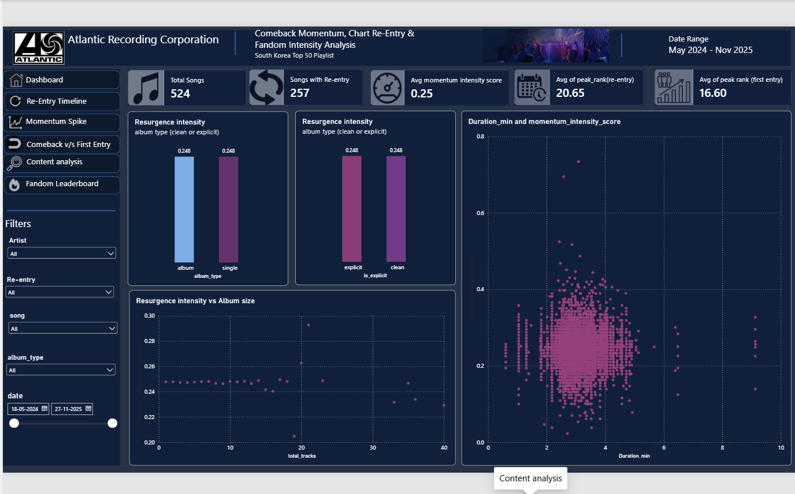
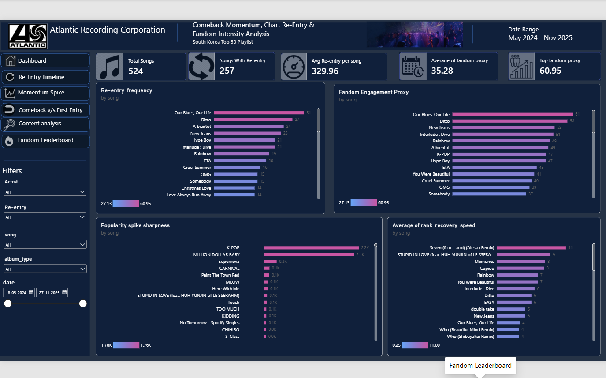

# Analysis-of-South-Korea-Top-50-Playlist
A Data-Driven Study of K-Pop Chart Dynamics, Comeback Performance, and Fandom Engagement

# Comeback Momentum, Chart Re-Entry, and Fandom Intensity Analysis of South Korea Top 50 Playlist

## Project Overview

This project analyzes song performance on the South Korea Top 50 playlist, focusing on chart re-entry, comeback momentum, post-comeback retention, and fandom engagement indicators.

The objective is to understand how songs regain chart visibility and perform after returning to the chart.

## Objectives

- Analyze recurring chart re-entries.
- Measure popularity changes and rank movements after comebacks.
- Evaluate post-comeback retention and chart stability.
- Explore the relationship between content attributes and comeback performance.
- Develop chart-based indicators of fandom engagement.

## Tools & Technologies

- **Python:** Data cleaning, feature engineering, and analysis.
- **Pandas & NumPy:** Data manipulation and numerical analysis.
- **Power BI:** Interactive dashboards and KPI visualization.
- **GitHub:** Project documentation and version control.

## Key Analysis

- **Chart Re-Entry Analysis:** Identifies returning songs, re-entry frequency, and absence periods.
- **Comeback Momentum:** Examines popularity changes, rank movements, and peak positions after re-entry.
- **Post-Comeback Sustainability:** Evaluates chart retention, rank decay, and post-peak volatility.
- **Content Attribute Analysis:** Compares comeback performance across album types, song duration, album size, and explicit content.
- **Fandom Engagement Proxies:** Uses re-entry frequency, popularity spike sharpness, and rank recovery speed as indirect engagement indicators.

## Dashboard Features

The Power BI dashboard provides an interactive overview of:
## 📸The project includes interactive visualizations designed to explore chart performance and comeback behavior.

- **Dashboard:** Overview about the content.

  

- **Re-Entry Timeline:** Tracks song appearances and comeback events over time.

  

- **Momentum Spike Analysis:** Examines popularity changes and rank movements.
  

- **Comeback vs. First Entry:** Compares initial chart appearances with comeback performance.

  

- **Content Attribute Analysis:** Explores the relationship between content characteristics and momentum.

  

- **Fandom Intensity Leaderboard:** Highlights songs using chart-based engagement indicators.

  

**Filters:** Date range, song, artist, re-entry frequency, and album type.

## Author

**Abha Patel**

Aspiring Data Analyst | Python | SQL | Power BI | Excel

